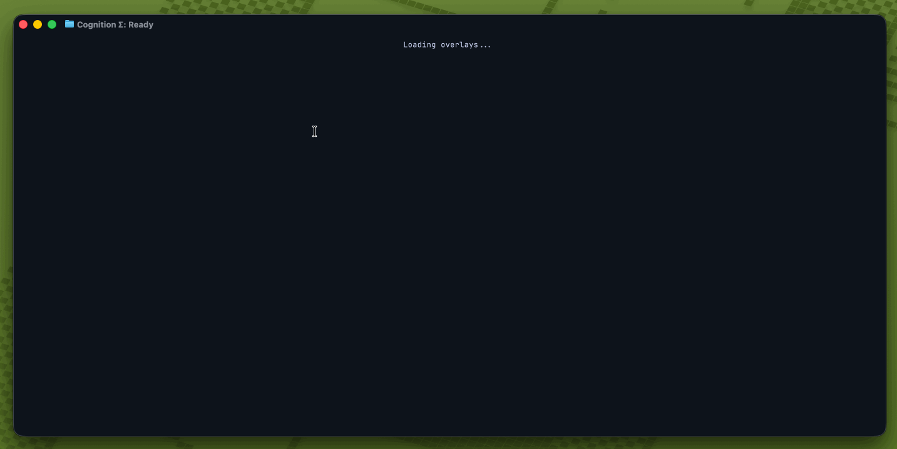

# Cognition Σ CLI

[](https://doi.org/10.5281/zenodo.18012832)

**Cognition Σ CLI** is a terminal-based agentic coding tool that transforms your codebase into a queryable knowledge graph with infinite context.



## Installation

```bash
cd src/cognition-cli
npm install && npm run build && npm link
```

## Quick Start

```bash
# Initialize your project
cognition-cli wizard

# Launch the interactive TUI
cognition-cli tui
```

## LLM Providers

Cognition CLI supports multiple providers via environment variables.

### Gemini (Default)

Connect via API key or Vertex AI:

```bash
export GEMINI_API_KEY=your-key-here
# OR
export GOOGLE_GENAI_USE_VERTEXAI=true
```

### Claude

Requires manual installation due to licensing:

```bash
npm install @anthropic-ai/claude-agent-sdk
export ANTHROPIC_API_KEY=sk-ant-...
cognition-cli tui --provider claude
```

### OpenAI / Local

Supports official OpenAI API or local models via **[eGemma workbench](https://github.com/mirzahusadzic/egemma)**:

```bash
export OPENAI_API_KEY=sk-...
cognition-cli tui --provider openai
```

**[eGemma](https://github.com/mirzahusadzic/egemma):** Auto-detects local `gpt-oss` models from the workbench and provides embedding generation for the Conversation Lattice.

## Features

- **Infinite Context**: Intelligent session compression that never forgets important context.
- **Dual-Lattice Architecture**: Grounded reasoning across your codebase (Project Lattice) and session history (Conversation Lattice). Uses **[eGemma](https://github.com/mirzahusadzic/egemma)** for local embedding generation.
- **Seven Cognitive Overlays**: Deep analysis across Structural, Security, Lineage, Mission, Operational, Mathematical, and Coherence layers.
- **Multi-Provider Support**: Seamlessly switch between Gemini, Claude, and OpenAI/local models.
- **Verifiable & Reproducible**: Grounded analysis.

## 📖 Documentation

### Getting Started

- **[00 - Introduction](docs/guides/00_Introduction.md)** — Overview and core concepts
- **[Complete Lattice Book](https://mirzahusadzic.github.io/cogx)** — 21-chapter reference manual
- **[CogX Blueprint](../../README.md)** — Theoretical foundations and vision

### Implementation Guides

- **[01 - Structural Analysis](docs/guides/01_Structural_Analysis.md)** — Code understanding
- **[02 - Core Infrastructure (PGC)](docs/guides/02_Core_Infrastructure.md)** — Four pillars
- **[03 - Commands Reference](docs/guides/03_Commands.md)** — Complete CLI reference
- **[04 - Miners and Executors](docs/guides/04_Miners_and_Executors.md)** — Transform pipeline
- **[05 - Verification and Oracles](docs/guides/05_Verification_and_Oracles.md)** — Validation
- **[06 - Testing and Deployment](docs/guides/06_Testing_and_Deployment.md)** — Production usage

### Advanced Topics

- **[07 - AI-Grounded Architecture Analysis](docs/guides/07_AI_Grounded_Architecture_Analysis.md)** ⭐ — Zero-hallucination analysis
- **[08 - Claude Code Integration](docs/guides/08_Claude_CLI_Integration.md)** 🤖 — TUI details
- **[09 - Mission Concept Extraction](docs/guides/09_Mission_Concept_Extraction.md)** — Strategic alignment
- **[10 - Mission Security Validation](docs/guides/10_Mission_Security_Validation.md)** — Security validation
- **[11 - Internal Architecture](docs/guides/11_Internal_Architecture.md)** 🏗️ — System internals

### Architecture Documentation

- **[Comprehensive Analysis](docs/architecture/COMPREHENSIVE_ANALYSIS.md)** 📊 — Complete system analysis and metrics
- **[SIGMA Architecture](docs/sigma/ARCHITECTURE.md)** ⭐ — Official Σ architecture document
- **[Session Boundary Rationale](docs/sigma/SESSION_BOUNDARY_RATIONALE.md)** — Design patterns and rationale
- **[Dual-Use Mandate](docs/guides/DUAL_USE_MANDATE.md)** — Security philosophy
- **[Operational Lattice](docs/guides/OPERATIONAL_LATTICE.md)** — O₅ workflows
- **[Vision Document](docs/guides/VISION.md)** — Project vision and goals

## License & Citation

Licensed under **AGPL-v3**.

```bibtex
@software{cognition_cli_2026,
  author = {Husadžić, Mirza},
  title = {Cognition Σ CLI: Seven-Overlay Knowledge Graph with Infinite Context},
  year = {2026},
  version = {2.7.3},
  doi = {10.5281/zenodo.18012832},
  url = {https://github.com/mirzahusadzic/cogx/tree/main/src/cognition-cli}
}
```
